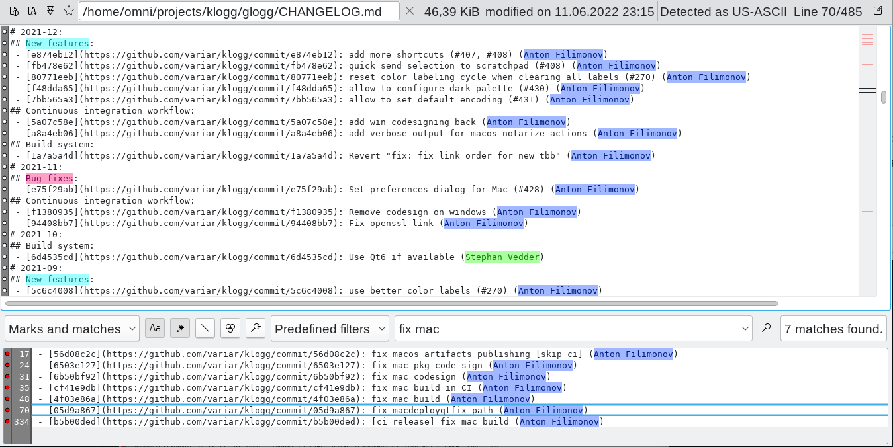

> **This is a maintenance fork of [variar/klogg](https://github.com/variar/klogg)**, which itself is a fork of
> [glogg](https://github.com/nickbnf/glogg). See [About this fork](#about-this-fork) for what is different.

Check [GitHub releases](https://github.com/wojtekadams/klogg/releases/tag/continuous) for Windows installers and Linux/Mac packages.

## Overview

Klogg is a multi-platform GUI application that helps browse and search
through long and complex log files. It is designed with programmers and
system administrators in mind and can be seen as a graphical, interactive
combination of grep, less, and tail.

Please refer to the
[documentation](DOCUMENTATION.md)
page for how to use Klogg.

### Latest builds

| Windows | Linux | Mac |
| ------------- |------------- | ------------- |
| [installer / portable](https://github.com/wojtekadams/klogg/releases/tag/continuous) | [deb / AppImage](https://github.com/wojtekadams/klogg/releases/tag/continuous) | [dmg (Apple Silicon)](https://github.com/wojtekadams/klogg/releases/tag/continuous) |

The upstream [changelog](CHANGELOG.md) covers changes up to the fork point.

## Table of Contents

1. [About this fork](#about-this-fork)
1. [About the Project](#about-the-project)
1. [Installation](#installation)
1. [Building](#building)
1. [How to Get Help](#how-to-get-help)
1. [Contributing](#contributing)
1. [License](#license)
1. [Authors](#authors)

## About this fork

This repository is an **uplift of klogg** to current toolchains and dependencies, done with
[Claude Code](https://claude.com/claude-code) (Anthropic's AI coding agent) under human review.
The work was driven through pull requests in this repository; every change went through CI on all supported platforms.

Project lineage:

1. [glogg](https://github.com/nickbnf/glogg) by Nicolas Bonnefon - the original fast, smart log explorer
2. [klogg](https://github.com/variar/klogg) by Anton Filimonov - fork of glogg started in 2016, rewritten for speed and features
3. **this fork** - klogg brought up to date with current compilers, Qt and libraries

What changed compared to upstream klogg (v24.11 development branch), released as version 26.11:

* Builds with current toolchains: GCC 13-15, MSVC 2026 (VS 18), Apple Clang, CMake 4, Qt 6.4 - 6.10
* Third-party libraries updated (efsw, CRoaring, simdutf, Catch2 3, mimalloc 3, vectorscan, oneTBB, ...)
  with the source fixes they required
* Supported platforms: Ubuntu 24.04 and 26.04 (`.deb`), any Linux with glibc 2.35+ (AppImage),
  Windows x64 (installer and portable), macOS on Apple Silicon (`.dmg`, currently unsigned)
* Dropped: Oracle Linux, Ubuntu 18.04/20.04/22.04 packages, 32-bit Windows, Qt 5 builds, macOS on Intel
* Removed Sentry crash reporting and the Discord integration; Windows uses the native schannel TLS backend
  instead of bundling OpenSSL 1.1
* Modernized GitHub Actions CI and a new release workflow publishing all packages to GitHub releases

All credit for klogg itself goes to its original authors - see [Authors](#authors).

**[Back to top](#table-of-contents)**

## About the Project

Klogg started as a fork of [glogg](https://github.com/nickbnf/glogg) - the fast, smart log explorer in 2016.

Since then it has evolved from fixing small annoying bugs to rewriting core components to
make it faster and smarter that predecessor.

Development of klogg is driven by features my colleagues and I need
to stay productive as well as feature requests from users on Github and in glogg mailing list.

Latest news about upstream klogg development can be found at https://klogg.filimonov.dev.

### Comparing with glogg

Klogg has all best features of glogg:

* Runs on Unix-like systems, Windows and Mac thanks to Qt5
* Is fast and reads the file directly from disk, without loading it into memory
* Can operate on huge text files (10+ Gb is not a problem)
* Search results are displayed separately from original file
* Supports Perl-compatible regular expressions
* Colorizes the log and search results
* Displays a context view of where in the log the lines of interest are
* Watches for file changes on disk and reloads it (kind of like tail)
* Is open source, released under the GPL

And on top of that klogg:

* Is heavily optimized using multi-threading and SIMD
* Supports files with more than 2147483647 lines
* Includes much faster regular expressions search (2-4 times)
* Allows combining regular expressions with boolean operators (AND, OR, NOT)
* Supports many common text encodings
* Detects file encoding automatically using [uchardet](https://www.freedesktop.org/wiki/Software/uchardet/) library (supports utf8, utf16, cp1251 and more) 
* Can limit search operations to some part of huge file
* Allows to configure several highlighters sets and switch between them
* Has a list of configurable predefined regular expression patterns
* Includes a dark mode
* Has configurable shortcuts
* Has a scratchpad window for taking notes and doing basic data transformations
* Provides lots of small features that make life easier (closing tabs, copying file paths, favorite files menu, etc.)

Here is a small demo showing how much faster klogg is (searching in ~1Gb file stored on tmpfs):

https://user-images.githubusercontent.com/1620716/117588567-bea39100-b12c-11eb-990a-90a667bcaeaa.mp4

List of glogg issues that have been fixed/implemented in klogg can be found [here](https://github.com/variar/klogg/discussions/302).

List of all upstream changes can be found [here](https://github.com/variar/klogg/milestone/8?closed=1).

**[Back to top](#table-of-contents)**

## Installation

This project uses [Calendar Versioning](https://calver.org/).

### Builds of this fork

Packages for all supported platforms are published on the
[continuous release](https://github.com/wojtekadams/klogg/releases/tag/continuous) page:

| Platform | Package |
| --- | --- |
| Windows x64 | `klogg-<version>-x64-Qt6-setup.exe` (installer) or `klogg-<version>-x64-Qt6-portable.zip` |
| Ubuntu 24.04 | `klogg-<version>-noble.deb` |
| Ubuntu 26.04 | `klogg-<version>-resolute.deb` |
| Other Linux (glibc 2.35+) | `klogg-<version>-x86_64.AppImage` |
| macOS (Apple Silicon) | `klogg-<version>-mac-arm64.dmg` |

Install a `.deb` package with `sudo apt install ./klogg-<version>-noble.deb`.

To run the AppImage, make it executable (`chmod +x klogg-*.AppImage`) and start it.
AppImages need FUSE 2; on recent Ubuntu install it with `sudo apt install libfuse2t64` (or `libfuse2` on 22.04).

The macOS package is not signed yet. On first start macOS will block it - open it with right click -> Open,
or remove the quarantine flag: `xattr -dr com.apple.quarantine /Applications/klogg.app`.

### Upstream klogg packages

Stable releases of the original klogg (without the changes from this fork) are available from
[variar/klogg releases](https://github.com/variar/klogg/releases/latest), distribution
[repositories](https://repology.org/project/klogg/versions), [Chocolatey](https://chocolatey.org/packages/klogg),
[Scoop](https://scoopsearch.github.io/#/apps?q=klogg), [Winget](https://winget.run/pkg/variar/klogg) and
[Homebrew](https://formulae.brew.sh/cask/klogg).

**[Back to top](#table-of-contents)**

## Building

Please review
[BUILD.md](BUILD.md)
for how to setup Klogg on your local machine for development and testing purposes.

## How to Get Help

First, please refer to the
[documentation](DOCUMENTATION.md)
page.

Issues with builds from this fork can be reported on [this repository's issues page](https://github.com/wojtekadams/klogg/issues).
Questions about klogg features in general are best asked in the [upstream klogg](https://github.com/variar/klogg/issues) project.

## Contributing

We encourage public contributions! Please review [CONTRIBUTING.md](CONTRIBUTING.md) for details on our code of conduct and development process.

## License

This project is licensed under the GPLv3 or later - see [COPYING](COPYING) file for details.

## Authors

* **[Anton Filimonov](https://github.com/variar)** - klogg
* *Initial work* - **[Nicolas Bonnefon](https://github.com/nickbnf)** - glogg
* *Fork maintenance* - **[wojtekadams](https://github.com/wojtekadams)**, uplift done with [Claude Code](https://claude.com/claude-code)

See also the list of [contributors](https://klogg.filimonov.dev/docs/getting_involved/#contributors) who participated in this project.

**[Back to top](#table-of-contents)**
